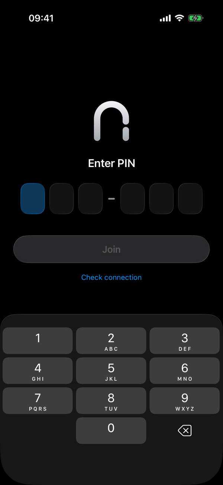
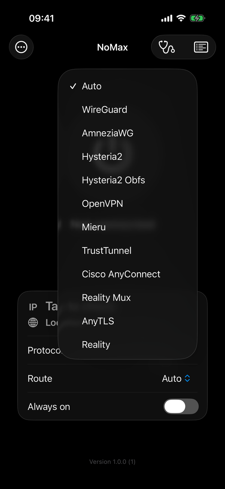
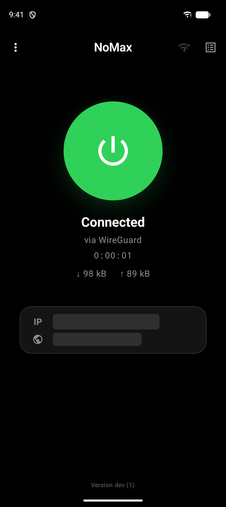
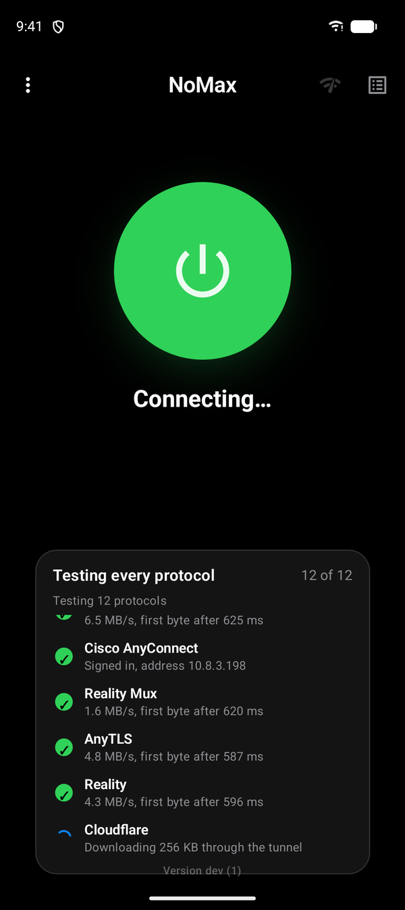

# NoMax VPN

A self-hosted VPN server with 13 protocols, optional relays, and native apps for iOS, macOS,
Android and Windows.

For educational and research purposes only.

<p>
  
  
  
  
</p>

## Features

- **Protocols**: WireGuard, AmneziaWG, Hysteria2 (plain, and obfuscated with port hopping),
  VLESS Reality (Vision, and multiplexed), AnyTLS, Mieru, TrustTunnel, OpenConnect, OpenVPN,
  IKEv2, and VLESS over WebSocket through Cloudflare.
- **Auto mode**: the apps try protocols in turn, starting with the last one that worked, and
  switch when a tunnel stops carrying traffic.
- **Relays**: any small VPS can forward every protocol to the server; the first can also be the
  exit.
- **Onboarding**: invite devices from the admin panel with a one-time PIN or QR code.
- **Discovery**: apps find the server after it moves, through a signed, encrypted record in DNS.
- **Diagnostics**: connection checks, logs, and reports sent from the apps to the server.
- **One binary**: the server is a single Go program, with its state in one SQLite file.

## Layout

| Path | Contents |
| --- | --- |
| `cmd/server` | Server |
| `cmd/ops` | Deploy and maintenance tool behind `make` |
| `core/` | Go core shared by all apps |
| `apple/` | iOS and macOS app |
| `android/` | Android app |
| `windows/` | Windows app |
| `infra/` | OpenTofu for the VPS and DNS, host setup scripts |

## Requirements

- A Debian 13 server with a public IPv4 address and root SSH access
- A domain, with `DOMAIN`, `v4.DOMAIN` and `m.DOMAIN` pointing to the server
- Go and make
- Apps: Xcode and XcodeGen (Apple), JDK 21 and the Android SDK and NDK (Android), makensis (Windows)

## Setup

```sh
make init                              # writes _cert/nomax.env with generated keys, and _cert/ssh_ed25519
```

Set `DOMAIN` in `_cert/nomax.env` and add `_cert/ssh_ed25519.pub` to `/root/.ssh/authorized_keys`
on the server, then:

```sh
SERVER_HOST=203.0.113.10 make deploy   # installs and configures everything over SSH
make probe                             # sends traffic through every protocol
```

Sign in at `https://DOMAIN/ADMIN_PATH` with `ADMIN_CODE` from `_cert/nomax.env` and add devices.
All secrets stay in `_cert/`, which git ignores; back it up. The site at `/` is a placeholder page
in `internal/panel/web/home/index.html`.

### Optional providers

- **Cloudflare**: the Cloudflare protocol needs `web.DOMAIN` proxied through Cloudflare (SSL
  "Full (strict)"), and `make publish` keeps the apps' DNS directory there. Without it, the other
  protocols work as usual.
- **UpCloud**: with `UPCLOUD_TOKEN` and the `CLOUDFLARE_*` values in `_cert/nomax.env`, `make up`
  creates the server and all DNS records with OpenTofu (needs `tofu`) and deploys; `make down`
  saves the state and removes them.

## Apps

| Platform | Build |
| --- | --- |
| Android | `ANDROID_ARGS=-upload make android-release` |
| Windows | `WINDOWS_ARGS=-upload make windows` |
| iOS, macOS | Set `YOUR_TEAM_ID` and `com.example` in `apple/project.yml` and `cmd/ops/ios.go`, add the `ASC_*` keys to `_cert/nomax.env`, then `make ios-setup` and `make testflight` or `make testflight-mac` |

`-upload` publishes the build on the server's join page. Devices without the app can use the
WireGuard, AmneziaWG, OpenVPN and IKEv2 configs and share links the panel provides.

## Relays

```sh
RELAY=203.0.113.7 RELAY_PASSWORD=... make relay
```

A relay forwards every protocol's port to the server and holds no keys or user data. To have Auto
use the relay first on networks in a given country, set `RelayCountry` in
`internal/profile/profile.go`.

## Operations

```sh
make deploy       # roll out a new server build
make check        # services, ports, certificate
make reports      # reports sent from the apps
make admin-code   # rotate the admin code
make state-save   # copy users, devices and keys to _cert/state.tgz; the next new server restores them
```

CI runs gofmt, vet and the tests, including real loopback tunnels. After `make gh-secrets`, pushes
to `main` also deploy the server and build the apps.
